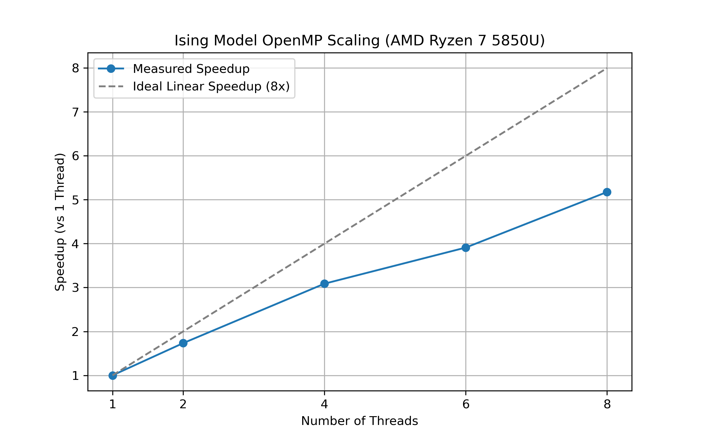

# 2D Ising Model Monte Carlo Simulation (C++ / OpenMP)

A high-performance C++ implementation of the 2D Ising model using the Metropolis algorithm. The simulation is parallelized using OpenMP to sweep across multiple temperatures simultaneously, significantly reducing wall-clock time.

## Physics Validation
The simulation accurately reproduces the Onsager exact solution for the 2D Ising model. As seen in the output, the system undergoes a phase transition at the critical temperature $T_c \approx 2.269$
*   **Ordered Phase (T=2.0):** Spontaneous magnetization $|m| \approx 0.91$
*   **Critical Point (T=2.269):** Magnetization drops sharply to $|m| \approx 0.53$
*   **Disordered Phase (T=3.0):** Thermal fluctuations destroy order, $|m| \approx 0.08$

## Performance & Scaling (OpenMP)
Benchmarked on an 8-core AMD Ryzen 7 5850U (Zen 3 architecture, Fedora Linux). 

| Threads | Wall Time (s) | Speedup | Parallel Efficiency |
|---|---|---|---|
| 1 | 3.375 | 1.00x | 100% |
| 2 | 1.947 | 1.73x | 86.6% |
| 4 | 1.093 | 3.09x | 77.2% |
| 8 | 0.652 | **5.18x** | 64.7% |

### Conclusion: The Memory Bandwidth Wall
The parallel efficiency drops from 86% (at 2 threads) to 64% (at 8 threads). This is a classic HPC bottleneck: **memory bandwidth saturation**. Because all 8 threads are reading and writing to the same shared RAM, the CPU cores eventually spend more time waiting for memory transfers than doing actual calculations. 



## Key HPC Implementation Details
- **Random Number Generator:** Custom 64-bit Xorshift (period \(2^{64}-1\)) passed by pointer to avoid `std::mt19937` overhead and prevent OpenMP thread contention.
- **Cache Optimization:** Spins are stored as 1-byte `signed char` instead of 4-byte `int` to maximize L1/L2 cache hit rates.
- **Precomputed Weights:** The Boltzmann factor \(e^{-\beta \Delta E}\) is precomputed into a 5-element array, eliminating expensive `exp()` calls from the hot loop.

## How to compile and run
```bash
g++ -O2 -march=native -fopenmp sweep.cpp -o sweep
OMP_NUM_THREADS=8 ./sweep
